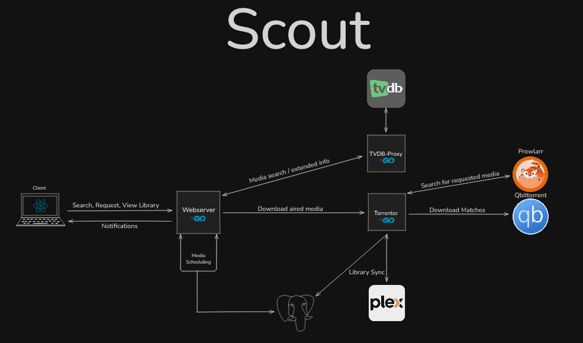

# Scout

Over-engineered microservices architecture for automated media torrenting with a web interface.




## ⚠️ Security Notice

**Before deploying Scout, you must configure environment variables properly.** This repository does not include actual credentials.

1. Copy `.env.template` to `.env` and fill in your secrets
2. Never commit your `.env` file (protected by `.gitignore`)
3. See [DEPLOYMENT.md](DEPLOYMENT.md) for detailed setup instructions

## 🏗️ Architecture

Scout is built as four microservices that work together:

- **webserver** (Go): Central coordinator, REST API, episode scheduling, followed shows, outbound notifications
- **tvdb-proxy** (Go): TVDB API proxy for media search and metadata
- **torrenter** (Go): Download processor with qBittorrent, Prowlarr and Plex integration, runtime settings, indexer health, quality upgrades
- **ui** (React/TypeScript): Web interface for search and management

The three Go services live in one module under `backend/` (`cmd/<service>` for wiring, `internal/<service>` for the code, `pkg/` for what they share). Schema migrations are embedded in `backend/pkg/dbmigrate` and applied automatically when the webserver or torrenter starts.

## ✨ What it does

- Search TVDB with years, people and filters; request a movie, a season or single episodes; aired episodes are searched for right away and future ones scheduled for release.
- Picks torrents by quality, seeders and preferred uploaders, with a quality floor, a disk-space guard and dead-swarm replacement; links finished files into Plex and fetches subtitles.
- **Activity** page: every request's stage, retry schedule and failure reason; cancel an item, retry it now, or pick the release yourself; an Upcoming list of everything scheduled; indexer health with the host's exit relay.
- **Follow a show** so new seasons are requested automatically; a **Missing** tab lists aired episodes your library lacks with a one-click fill.
- **Settings** page: quality floor, free-space reserve, preferred uploaders, subtitles, Plex sync timing, season packs, quality upgrades, relay rotation, and notification targets (webhook / Home Assistant, ntfy, Discord), all changeable at runtime.
- Optional **season packs** (one torrent for a season) and **quality upgrades** (replace copies below a cutoff), both off until enabled.
- Optional **Mullvad relay rotation**: with `tools/relay-agent` on the host, a Cloudflare ban on an indexer moves the exit IP and re-enables the indexer on its own.

## 🚀 Quick Start with Docker Compose (Recommended)

### Prerequisites
- Docker (version 20.10+)
- Docker Compose (version 2.0+)
- At least 4GB RAM available for Docker

### Deploy Scout
```bash
# Copy template files and configure
cp .env.template .env
cp docker-compose.yml.template docker-compose.yml
cp nginx/nginx.conf.template nginx/nginx.conf
nano .env  # Fill in your API keys and credentials

# Deploy all services
./compose-deploy.sh
```

Access Scout at `http://localhost:30030` or `http://<YOUR_LAN_IP>:30030`

### Development Workflow
```bash
# Rebuild a service after changes
./compose-deploy.sh rebuild webserver

# View logs
./compose-deploy.sh logs torrenter

# Check status
./compose-deploy.sh status

# See all commands
./compose-deploy.sh --help
```

See [DEPLOYMENT.md](DEPLOYMENT.md) for detailed documentation.

## 🐳 Running Services Locally (Without Docker)

Each service can run independently for development (all Go commands from `backend/`):

```bash
cd backend
export $(grep -v '^#' ../.env | xargs)
go run ./cmd/tvdb-proxy    # localhost:22000
go run ./cmd/torrenter     # localhost:22001
go run ./cmd/webserver     # 0.0.0.0:22920 (BIND_ADDRESS)

cd ../ui
npm install
npm run dev                # localhost:5173, proxies /api to the webserver
```

Tests: `cd backend && go test ./...` and `cd ui && npm test`.

**Configuration Note:** Services read environment variables (from `.env` or exported), then defaults coded in the services. The Settings page overrides the download, subtitle, sync, pack, upgrade and relay knobs at runtime without a restart.

## 📋 Configuration

All configuration is managed via the `.env` file. See [DEPLOYMENT.md](DEPLOYMENT.md) for complete instructions.

Quick setup:
```bash
# Copy template
cp .env.template .env

# Edit with your credentials
nano .env  # or use your preferred editor
```

Required secrets:
- **TVDB** API credentials (api-key, token) - Get from https://thetvdb.com/api-information
- **Prowlarr** API key - Find in Prowlarr Settings → General
- **qBittorrent** credentials (username, password)
- **Plex** token and library sections - Get token from https://support.plex.tv/articles/204059436
- **Database** password (optional, has default: scoutpass)

### Optional integrations
- **Subtitles**: `OPENSUBTITLES_API_KEY` (+ account) turns on subtitle fetching.
- **Relay rotation**: install `tools/relay-agent` on the host and set `RELAY_AGENT_URL` / `RELAY_AGENT_TOKEN`; see `tools/relay-agent/README.md`.
- **Notifications**: add webhook, ntfy or Discord targets on the Settings page; a Home Assistant webhook URL works as a webhook target.

## 🔧 Tech Stack

**Backend:**
- Go 1.24+
- Gin web framework
- PostgreSQL (shared database for all services)
- OpenTelemetry tracing and logs (SigNoz)

**Frontend:**
- React 19
- TypeScript
- Material-UI
- Vite

**Infrastructure:**
- Docker Compose
- Docker multi-stage builds
- Named volumes (PostgreSQL) and bind mounts (/data)
- Nginx reverse proxy

**Integrations:**
- TVDB API v4 (media metadata)
- qBittorrent (torrent downloads)
- Plex Media Server (library management)
- Prowlarr (indexer management)

## 📁 Project Structure

```
Scout/
├── webserver/                    # Central coordinator service (Go)
│   ├── cmd/webserver/            # Entry point
│   │   └── main.go
│   └── internal/                 # Private packages
│       ├── handlers/             # HTTP handlers
│       ├── interactors/          # Business logic
│       ├── clients/              # Service clients
│       ├── repository/           # Database layer
│       ├── scheduler/            # Episode scheduler
│       └── config/               # Configuration
├── torrenter/                    # Download processor (Go)
│   ├── cmd/torrenter/            # Entry point
│   │   └── main.go
│   └── internal/                 # Private packages
│       ├── handlers/             # HTTP handlers
│       ├── interactors/          # Business logic
│       ├── service/              # Domain services (torrent, plex, media processor)
│       ├── repository/           # Database layer
│       ├── models/               # Data structures
│       └── config/               # Configuration
├── tvdb_proxy/                   # TVDB API proxy (Go)
│   └── main.go                   # Single file service
├── ui/                           # React frontend
│   ├── src/
│   │   ├── components/           # React components
│   │   ├── App.tsx
│   │   └── main.tsx
│   └── package.json
├── shared/                       # Shared Go modules
│   ├── media/                    # TVDB data structures
│   ├── status/                   # Download status types
│   └── telemetry/                # OpenTelemetry tracing utilities
├── sql/                          # Fresh-database bootstrap (setup-postgres.sql)
├── nginx/                        # Nginx reverse proxy configuration
├── docker-compose.yml            # Docker Compose orchestration
├── .env.template                 # Environment variables template
└── compose-deploy.sh             # Deployment and management script
```

## 🎯 Features

- **Media Search**: Search TVDB for TV shows and movies
- **Automatic Downloads**: Scheduled downloads for new episodes
- **Anime Support**: Detects and handles anime differently
- **Plex Integration**: Automatic library syncing
- **Episode Scheduling**: Downloads episodes as they air
- **Multi-season Support**: Batch download entire seasons

## 🔐 Security

**READ THIS BEFORE DEPLOYMENT:** Configure your `.env` file properly

Important security practices:
- Configure `.env` file from `.env.template` before deployment
- Never commit your `.env` file (`.gitignore` protects you)
- Rotate credentials if you suspect exposure
- Use strong, unique passwords for all services
- For production, consider external secret managers (HashiCorp Vault, AWS Secrets Manager, etc.)

The repository includes:
- `.env.template` file with all required variables documented
- Comprehensive deployment documentation in DEPLOYMENT.md
- `.gitignore` rules to prevent credential leaks

## 📚 Documentation

- [Deployment Guide](DEPLOYMENT.md) - Docker Compose setup, LAN access, troubleshooting
- [Architecture Overview](CLAUDE.md) - Microservices architecture, data flow, development commands
- [Observability](OBSERVABILITY.md) - OpenTelemetry tracing and structured logging
- Service READMEs: [webserver](webserver/README.md), [torrenter](torrenter/README.md), [tvdb_proxy](tvdb_proxy/README.md), [ui](ui/README.md)

## 🤝 Contributing

1. Make changes to a service
2. Test locally:
   - Go services: `go run cmd/<service>/main.go` (or `go run main.go` for tvdb_proxy)
   - UI: `npm run dev`
3. Test with Docker Compose: `./compose-deploy.sh rebuild <service>`
4. Check logs: `./compose-deploy.sh logs <service>`
5. Run tests: `go test ./...` (in service directory)
6. Run linter: `golangci-lint run` (in service directory)

## 📝 License

MIT
